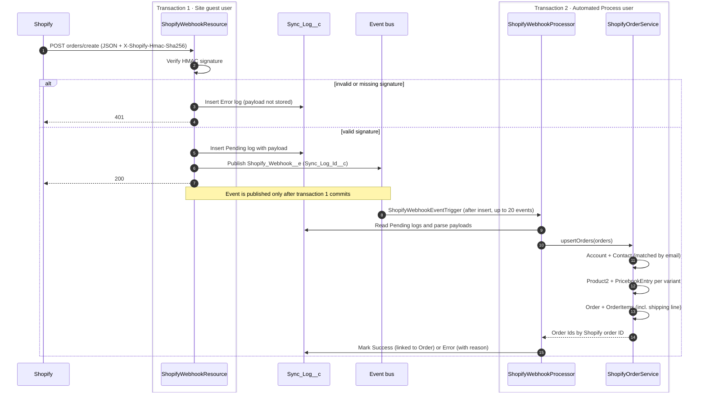

# Shopify → Salesforce Order Hub

Bi-directional, event-driven integration between a real [Shopify](https://www.shopify.com/)
storefront and Salesforce. Shopify acts as the system of record for orders;
Salesforce serves as the back office where orders are processed, invoiced,
monitored and reconciled.

This is a custom order hub built on the standard `Order` / `OrderItem`
objects. It deliberately does not use the
[Salesforce Order Management](https://www.salesforce.com/commerce/order-management/)
product, so that the integration, async processing and UI are written by hand
on the core platform.

> See the [roadmap](#roadmap) for current status.

## Architecture

**Inbound (Shopify → Salesforce).** Shopify webhooks (`orders/create`,
`orders/updated`, `refunds/create`) call a public Apex REST endpoint exposed
through a Salesforce Site. The endpoint only verifies the
`X-Shopify-Hmac-Sha256` signature, stores the payload in `Sync_Log__c`,
publishes a `Shopify_Webhook__e` Platform Event and responds immediately.
The event's subscriber processes the payload outside the Site guest user
context: it links or creates the customer's Account and Contact by email,
creates products and price book entries per variant, and upserts the Order
and its lines using Shopify IDs as external IDs, making the operation
idempotent. Shipping is stored as an order line so `Order.TotalAmount`
matches Shopify's total. Out-of-order deliveries are ignored by comparing the
payload's `updated_at` with `Order.Shopify_Updated_At__c`. A trigger
framework (one trigger per object, handler pattern) creates invoices.

If the bulk upsert fails, the processor rolls it back and retries each order
on its own, so one bad payload only fails its own log. A failed order can be
reprocessed from its log, which keeps the original payload.

**Outbound (Salesforce → Shopify).** When an order status changes in
Salesforce, the Order trigger publishes an `Order_Status_Changed__e`
Platform Event. A subscriber trigger on the event enqueues a Queueable job,
which calls the Shopify GraphQL Admin API through a Named Credential.
Decoupling through Platform Events keeps the user's transaction free of
callouts and lets other subscribers react to the same event. Failed callouts
are retried via chained Queueables up to a configurable limit, then surfaced
in the UI for manual retry.

**Batch layer.** A nightly Batch Apex job reconciles the last 24 hours of
Shopify orders against Salesforce and logs discrepancies. A second batch
detects duplicate customer Accounts and flags merge candidates. Scheduled
Apex orchestrates both.

**UI.** Lightning Web Components: a sync-monitoring dashboard, a failed-sync
list with one-click retry, and a duplicate-review component.

**Configuration.** Runtime settings (retry limits, API version, feature
toggles) live in Custom Metadata Types, so behaviour can change without a
code deployment. Secrets are never stored in source control: the Admin API
token lives in a Named / External Credential, and the webhook signing key,
which Apex must read to compute the HMAC, lives in the protected
`Shopify_Settings__c` hierarchy custom setting, entered in Setup.

## Data model

| Object | Purpose | Key fields |
|---|---|---|
| `Order` (standard) | Shopify order header | `Shopify_Order_Id__c` (external ID), `Shopify_Order_Name__c`, `Financial_Status__c`, `Shopify_Fulfillment_Status__c`, `Shopify_Total_Price__c`, `Customer_Email__c`, `Shopify_Updated_At__c` |
| `OrderItem` (standard) | Order line | `Shopify_Line_Item_Id__c` (external ID), `Variant_Title__c` |
| `Product2` (standard) | Product variant | `Shopify_Product_Id__c`, `Shopify_Variant_Id__c` (external ID) |
| `Invoice__c` | Invoice generated from an order | `Order__c`, `Status__c`, `Invoice_Date__c`, `Due_Date__c`, `Total_Amount__c` |
| `Sync_Log__c` | Audit trail of every inbound/outbound sync | `Direction__c`, `Status__c`, `Event_Topic__c`, `Shopify_Reference__c`, `HTTP_Status_Code__c`, `Retry_Count__c`, `Payload__c`, `Error_Message__c`, `Order__c` |
| `Shopify_Webhook__e` | Platform Event handing verified webhooks to the processor (published after commit) | `Sync_Log_Id__c`, `Topic__c` |
| `Shopify_Settings__c` | Protected hierarchy custom setting | `Webhook_Secret__c` |
| `Order_Status_Changed__e` | Platform Event driving outbound sync (published after commit) | `Order_Id__c`, `Shopify_Order_Id__c`, `Previous_Status__c`, `New_Status__c` |

Shopify status picklists use Shopify's own tokens as value API names (e.g.
`partially_paid`). Access is granted through the `Order_Hub_Admin` permission
set. See [ADR 0001](docs/decisions/0001-standard-order-objects.md) for the
reasoning behind the model and [ADR 0002](docs/decisions/0002-asynchronous-webhook-processing.md)
for how webhooks are processed.

## Engineering standards

- **Testing.** Every class is covered by meaningful tests, not just for
  coverage: bulk tests (200 records), negative paths, and `HttpCalloutMock`
  for every callout.
- **Bulkification.** All triggers and services are written for bulk input
  and stay within governor limits.
- **Security.** Classes declare `with sharing` unless there is a documented
  reason not to; CRUD/FLS is enforced (`WITH USER_MODE` / `Security.stripInaccessible`).
  The public Site guest user has the minimum permissions needed to call the
  webhook endpoint, and every request is rejected unless its HMAC signature
  is valid.
- **Design decisions.** Significant decisions and their trade-offs are
  recorded in [`docs/`](docs/).

## Roadmap

The first milestone is a thin end-to-end slice. Later items add breadth on
top of that working path.

**Milestone 1: end-to-end slice**

- [x] SFDX project scaffold
- [x] Data model (standard `Order` / `OrderItem` / `Product2` + `Invoice__c`, `Sync_Log__c`)
- [ ] Trigger framework
- [x] Inbound webhook endpoint with HMAC verification (`orders/create`)
- [ ] CI/CD pipeline (deploy validation + Apex tests on every PR)

**Milestone 2: full sync**

- [ ] `orders/updated` and `refunds/create` webhooks with out-of-order handling
- [ ] Invoice generation and Account/Contact matching
- [ ] Outbound fulfillment sync (Platform Event → Queueable → GraphQL Admin API, with retry)
- [ ] Custom Metadata configuration

**Milestone 3: back office**

- [ ] Nightly reconciliation batch
- [ ] Customer deduplication batch
- [ ] LWC sync dashboard, failed-sync retry and duplicate review
- [ ] Demo video / GIF in this README

## Tech stack

Apex · Trigger framework · Platform Events · Asynchronous Apex (Queueable /
Batch / Scheduled) · Inbound REST (`@RestResource` + HMAC verification) ·
Shopify GraphQL Admin API via Named Credentials · Custom Metadata Types ·
Lightning Web Components · SFDX · GitHub Actions CI/CD

## Project structure

- `force-app/main/default/` — metadata source (classes, triggers, objects, LWC)
- `config/` — scratch org definitions
- `scripts/` — automation scripts
- `docs/` — design decisions and architecture documentation

## Development

Built with the [Salesforce CLI](https://developer.salesforce.com/tools/salesforcecli).
Common commands:

| Command | Purpose |
|---|---|
| `sf org login web` | Authorize an org |
| `sf project deploy start --source-dir force-app` | Deploy all metadata to the org |
| `sf project retrieve start --metadata <type>:<name>` | Retrieve metadata from the org |
| `sf apex run test --test-level RunLocalTests` | Run Apex tests |
| `sf org open` | Open the org in a browser |

## License

[MIT](LICENSE)
